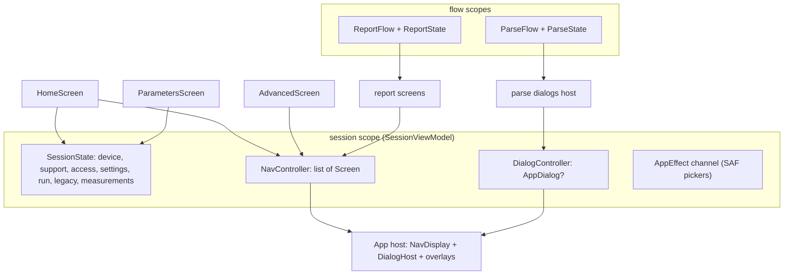
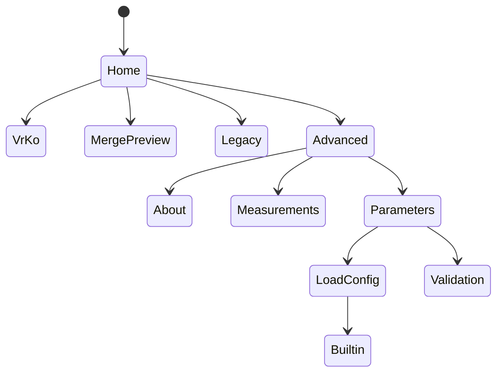

# UI architecture refactor plan (2026-11-21)

**Status:** proposed — awaiting operator approval. L-level change (public UI state structures and
cross-file contracts); per AGENTS.md no code lands before approval. The support verdict already has
its own design in `support-status-state-plan.md`; this plan re-homes that design as slice N3 and
sequences the rest of the UI around it.

**Baseline:** `document` @ `867f1294` (`feat(root): log the cached SELinux status before and after
the post-root repairs`, 2026-11-21).

## 1. 现状与基线 — current state and baseline

### 1.1 Measurements

| fact | value | where |
|---|---|---|
| screens | 13, all taking `GhostlockUiState` + `GhostlockActions` | `GhostlockUI.kt:491-529`; `AdvancedUI.kt` |
| one state bag | `GhostlockUiState`: **88 fields**, of which **16** are `*Visible` booleans and **15** are dialog fields | `GhostlockUI.kt:110` |
| one action bus | `GhostlockActions`: **87 methods** | `GhostlockUI.kt:276` |
| one ViewModel | **2,985 lines**, 83 `onXxx` overrides, **36 private `var`s**, one `MutableStateFlow` | `GhostlockViewModel.kt:144`, `:149` |
| UI sources | `GhostlockUI.kt` 2,043 lines, `AdvancedUI.kt` 1,384, UI package 7,647 | `app/src/main/kotlin/com/sesame/app/ui/` |
| navigation | two truths (16 booleans **and** a `NavBackStack`), three parallel mappings | `:382` `navigationPath`, `:420` `syncNavigationPath`, `:431` `closeScreen` |
| dialogs | one 15-field bus with a 6-variant `DialogType` shared by ~50 call sites | `:657` |
| UI tests | 4 files, all pure helpers; **none** references `GhostlockUiState` | `app/src/test/kotlin/com/sesame/app/ui/` |
| state restoration | no `SavedStateHandle`, no `rememberSaveable` | — |

### 1.2 The four structural causes

1. **One flat state bag.** Device facts, settings, run status, the editor session, the parse
   wizard, the report wizard, every dialog and every screen's visibility share one class. Every
   screen receives all 88 fields; nothing is encapsulated and nothing can be skipped on
   recomposition.
2. **State lives in three places.** The bag, 36 private `var`s in the ViewModel
   (`parseDialogStage`, `pendingConfirmation`, `pendingPhysImage`, `pendingParse`,
   `PendingProfileWrite`, …), and facts re-derived inside composables (`externalBlocked` at
   `GhostlockUI.kt:1626`). No single truth is inspectable or testable.
3. **Two navigation truths.** `onBack` mutates both the boolean flags (through `closeScreen`) and
   the `backStack` by hand (`:473-490`), while an effect reconciles the flags into the stack
   (`LaunchedEffect(desiredPath)` at `:460`). A screen addition requires edits to four places, and
   impossible combinations are representable.
4. **No boundary.** Any screen can call any of the 87 actions; `About` can call `onRun()`.
   Adding a feature means editing the same two files as everything else, and the compiler cannot
   tell what a change broke.

### 1.3 What this produces

`support-status-state-plan.md` §1's H1–H6, A1, A3, A5 and R1 are all instances of causes 1 and 2:
one boolean with four writers, no provenance, no serialization. The 327-line plan is the cost of
one card's verdict; the structure is the reason the cost is that high.

### 1.4 Baseline behavior that must not change (N0–N2, N4)

- All 968 string resources (zh/en), every log line, the run-store schema, the `AppEffect` channel
  (SAF pickers), the debug intents (`second_way`, `probe_check`, `preflight_check`,
  `fallback_test`), the harness entry points (执行 tap, run store), and the visual layout.
- The only intended behavior changes in this refactor are the ones already decided in
  `support-status-state-plan.md` (D1–D8), which land with N3, plus the deletion of the in-app
  profile editor (N4, §3.7), which is a feature removal rather than a visual change.

## 2. 目标与约束 — goals and constraints

### 2.1 Goals

- **G1 — one navigation truth.** A typed back stack is the only source of screen state; every
  back path (system back, swipe, close, notification) is one `pop()`.
- **G2 — one state owner per fact.** Device facts, the support verdict, settings and run status
  live in one session holder; editor/parse/report drafts live in their own flow holders. No fact
  has two writers and no screen reaches another screen's state.
- **G3 — a screen boundary the compiler enforces.** Each screen takes only its own state and its
  own actions.
- **G4 — typed dialogs.** One `AppDialog` type and one host; no 15-field dialog bus.
- **G5 — every derived verdict has one writer and a generation.** The support verdict is the
  pilot; the pattern is the rule for any future derived fact.
- **G6 — durability and tests.** Navigation and editor drafts survive process death; per-screen
  mapping is unit-tested.

### 2.2 Non-goals

- **No visual redesign.** The layout, the MIUIX components and the copy stay as they are. A
  separate visual/IA design discussion follows this plan; this plan is the structural prerequisite
  for it.
- **No in-app profile editor.** The editor is deleted, not refactored (2026-11-21 operator
  decision): the profile is a text file the user owns, and the app's job is to name the wrong
  field, not to render dozens of offsets as text fields. `ProfileOverride`, `AdvancedOverride` and
  `ProfileDiff` are deleted with their state; the replacement is the validation report (§3.7).
- No change to resolver semantics, field validators, profile format, the native wire, the attack
  routes, or the run protocol.
- No DI framework, no new UI toolkit, no Compose Navigation library swap.
- No one-ViewModel-per-widget; one holder per flow.
- No `UserProfileStore` decision beyond what the support plan already decides (its D2).

### 2.3 Acceptance criteria (measurable)

| criterion | today | target |
|---|---|---|
| state classes with > 15 fields | 1 (88) | 0 |
| screens taking the whole state + whole actions | 13 | 0 |
| actions in one interface | 87 | ≤ 20 per screen |
| `*Visible` navigation booleans | 16 | 0 |
| navigation mappings to keep in sync | 3 | 1 |
| dialog fields in the state bag | 15 | 0 |
| ViewModel files over 1,000 lines | 1 | 0 |
| UI state mapping tests | 0 | one per screen + the home verdict table |
| nav/editor survive process death | no | yes |

## 3. 改动清单 — change list

### 3.1 Target structure



| fact | owner | writer | readers |
|---|---|---|---|
| device snapshot, cpu pairs | `SessionState.device` | initialize / refresh | Home, Parameters |
| support verdict | `SessionState.support` | `refetchSupport()` only | Home, Parameters, run gate, toast |
| Shizuku enabled/status, manager | `SessionState.access` | toggle / listener / resume | Home, Advanced |
| settings (safe mode, force attack, vr.ko modes, debug log) | `SessionState.settings` | setting actions | Home, Advanced |
| run status, log lines, crash evidence | `SessionState.run` | run flow | Home, run sheet, report |
| legacy presence | `SessionState.legacy` | initialize / cleanup | Home, Parameters |
| measured kernels, merge rows | `SessionState.measurements` | measurement read | Measurements, Home merge row |
| parse wizard step | `ParseState` | parse flow only | parse dialogs |
| report wizard step | `ReportState` | report flow only | report screens |
| screen stack | `NavController` | push/pop only | host |
| open dialog | `DialogController` | `ask()`/`answer` only | host |

### 3.2 N1 — typed navigation

| file | change | reason |
|---|---|---|
| new `ui/nav/Screen.kt` | `sealed interface Screen : NavKey`; replaces `GhostlockScreen` | one screen vocabulary |
| new `ui/nav/NavController.kt` | `StateFlow<List<Screen>>`, `push`, `pop`, `replaceTop`, `reset`, `canPop`; invariants `stack[0] == Home`, `pop()` no-ops at Home | one navigation truth |
| `GhostlockUI.kt` | delete `navigationPath`, `syncNavigationPath`, `closeScreen`, the `onBack` ladder, the 13 `onClose*` actions, the 16 `*Visible` fields; render `nav.stack` | removes three mappings and the reconciliation effect |
| `GhostlockViewModel.kt` | `openX`/`closeX` pairs become `nav.push(Screen.X)` / `nav.pop()`; expose the stack | no hand-written screen state |
| `MainActivity.kt` | system back → `BackHandler { nav.pop() }` | one back path |
| tests | `NavControllerTest`, `NavGraphTest` (every screen reachable, push/pop round-trip, no pop below Home) | pins the graph |

The old precedence ladder becomes the graph:



`RunLogPicker` stays a typed dialog (it is opened over the run sheet, not from a screen). The run
sheet stays a global overlay whose visibility derives from `SessionState.run`, not a screen flag.
The three editor screens are deleted (§3.7); `Validation` is new.

### 3.3 N2 — typed dialogs
*Split at implementation (2026-11-21): **N2a** is the typed `AppDialog` model and the removal of
the 15-field bus; **N2b** is `ParseState`, the parse flow's own step machine.*| file | change | reason |
|---|---|---|
| new `ui/dialog/AppDialog.kt` | `sealed interface AppDialog { Confirm, Choice, Notice, TextInput, Stride, Overwrite, NotificationPermission }` with typed item models | each dialog is one type |
| new `ui/dialog/DialogController.kt` | `StateFlow<AppDialog?>`, `suspend fun ask(d): DialogResult`, `dismiss()`; one at a time via a mutex; cancellation releases the slot | call sites read as a question, not as postback fields |
| new `ui/dialog/DialogHost.kt` | one host, one `when`; the existing composables move here | one place renders every dialog |
| `GhostlockUI.kt` | delete `DialogType`, the 15 dialog fields, the generic `GhostlockDialog` bus | the bag loses 15 fields |
| `GhostlockViewModel.kt` | `showNotice`/`showRouteDialog`/`showPlanDialog`/`showPhysPrompt`/`showLockDialog`/`showOverwriteDialog` become `dialogs.ask(...)`; delete `pendingConfirmation`, `parseDialogStage`, `pendingParse`, `PendingProfileWrite` | removes the hidden state machine |
| new `ui/parse/ParseState.kt` | `sealed interface ParseStep`; the parse wizard owns its step | the parse flow stops borrowing the generic dialog |
| tests | `DialogCatalogTest` (each call site's title/body/buttons map to the same resources), `ParseFlowTest` | pins the dialogs against the N0 golden |

### 3.4 N3 — the support verdict

Exactly `support-status-state-plan.md`, re-homed:

- `SupportStatus`/`SupportOutcome` and `repository.supportOutcome()` land as designed (its S1).
- The verdict lives in `SessionState.support` (→ replaces the plan's `HomeState`), written only by
  `refetchSupport()` under its generation + mutex (its S2).
- The plan's editor-session split (its S2) is **withdrawn**: the editor is deleted, so H1 has no
  carrier. Its `FieldsInvalid(paths)` becomes `FieldsInvalid(errors)` so the card and the
  validation report can name the wrong field (§3.7).
- Its consumers (S3) become the per-screen actions of N4 for the home and parameters screens.
- Its D1–D8 decisions and S5 device gate stand unchanged.

### 3.5 N4 — screen states, actions, ViewModel split

One screen per commit, in this order: **first delete** `ProfileOverride`, `AdvancedOverride`,
`ProfileDiff` and their state (the editor decision, §3.7); then About, VrKo, Measurements,
MergePreview, Legacy, Advanced, Parameters, LoadConfig, Builtin, Home, RunSheet.

| change | reason |
|---|---|
| new `ui/home/`, `ui/parameters/`, `ui/validation/`, `ui/advanced/`, `ui/about/`, `ui/measurements/`, `ui/legacy/`, `ui/vrko/`, `ui/components/`, `ui/runsheet/` | one file set per screen |
| delete `GhostlockUI.kt`, `AdvancedUI.kt`, `GhostlockUiState`, `GhostlockActions` | the god objects |
| `GhostlockViewModel` → `SessionViewModel` (session state, nav, dialogs, run) + `ParseFlow` + `ReportFlow` + `RunController` | one owner per flow; holders are plain classes with a `CoroutineScope` |
| per-screen `XActions` interfaces (≤ 20 methods) | compiler-enforced boundary |
| tests | `XStateMappingTest` per screen; `RunSheetStateTest`; the support plan's matrix | each screen's mapping is pinned |

`GhostlockEffect` stays a single session-level channel (SAF pickers and notification permission are
Activity-scoped), but the effects it carries become one sealed `AppEffect`.

### 3.6 N5 — durability and tests

| change | reason |
|---|---|
| `Screen` gets a `Saver`; the stack and the open editor draft go into `SavedStateHandle` | process death today loses everything |
| navigation host reads the restored stack | same |
| `kotlinx-coroutines-test` (test-only, `runTest` + a gated dispatcher) | the support plan's race tests need it |
| Compose tests for the home status card only (Robolectric + `ui-test-junit4`) — **experiment in N0**; if Miuix does not compose under Robolectric, fall back to the screenshot matrix alone and record it | the card is the one place where a rendered-state table pays for itself |

### 3.7 — the editor is deleted; the validation report replaces it

| file | change | reason |
|---|---|---|
| `AdvancedUI.kt` / `GhostlockUI.kt` | delete `ProfileOverrideScreen`, `AdvancedOverrideScreen`, `ProfileDiffScreen`, their actions (`onProfileOverride*`, `onOpenProfileOverrides`, `onOpenAdvancedOverrides`, `onOpenProfileDiff`, `onRebaseToBundle`, …) and their state (`editTargetName`, `profileOverride*`, `profileDiffVisible`, `diffRows`, `executionEditing`) | the editor is a worse text editor for a file the user owns |
| `profile-core` `ConfigError` | stays; the controller stops discarding `message` | the type already carries `fieldPath` + `message` |
| `AndroidProfileConfigController.kt` | `ProfileConfig.invalidErrors: List<FieldError>`; `validateProfileFields` returns errors (path, current value, message), not bare paths; `invalidPaths` stays as a derived set | "which field is wrong" must survive to the UI |
| new `ui/validation/ValidationScreen.kt`, `Screen.Validation` | one list: path, current value, rule; a copy action per row; the export action at the top | the report is the replacement surface |
| Home status card | `FieldsInvalid(errors)` shows 配置需要修正 · N 项 and opens the report | the action replaces "fix in the editor" |
| Parameters | the 当前配置 card offers 查看问题 and 导出配置 | export → edit → re-import is the flow |

The report shows the dotted key path (the file's own key name), the current value and the rule that
failed; the copy action yields a line that can be pasted into a text editor's search. The parser
resolves to a map and carries no source positions, so line numbers are out of scope. The same
error list feeds the run gate, so the card, the report and the blocked toast cannot disagree.

Limit to record: the rules name what they know — required/typed keys, `cred` and `task_struct`
offsets, geometry, the anchor trio, route/waiter shape, the physical pair. A structurally valid
profile with a plausible wrong offset still runs and fails; that is a device run, not a validator.

`MergePreview` stays: it merges measured facts into a new document, which is generation work, not
editing.

## 4. 数据流/控制流差异

### 4.1 Navigation

- **Old:** `state.advancedScreenVisible` → `navigationPath()` → `syncNavigationPath()` on an effect;
  `onBack` → `closeScreen()` + `backStack.removeAt`; each screen's close is a distinct action.
- **New:** the action calls `nav.push(...)` / `nav.pop()`; the host renders `nav.stack`; the system
  back, swipe-back and close button all call the same `pop()`.
- **Invariants:** `stack[0] == Home`; `pop()` at Home is a no-op and does not exit the app (the
  Activity's default back finishes it, as today); a screen cannot be pushed twice in a row.

### 4.2 State ownership

- **Old:** `refreshSnapshot()` and `applyExecutionConfig()`/`applyAdvancedConfig()` both write
  `kernelSupported`/`executionHasProfile`/`profileInvalidPaths`/`profileLayers`. The editor session
  called the same `apply*` functions (the H1 leak); the editor is deleted, but the duplicate
  writers remain until N3/N4.
- **New:** `refetchSupport()` is the only writer of `SessionState.support`; the home reads it by
  reference.
- **Invariant:** for any state object, every field has exactly one writer named in §3.1. A test
  per fact asserts it (`SupportRefetchRaceTest` is the pilot).

### 4.3 Dialogs

- **Old:** a call site sets `dialogVisible` + `dialogType` + up to 13 more fields; the answer comes
  back through a separate `onDialogConfirm`/`onDialogItemSelected` action with private postback
  variables.
- **New:** `val result = dialogs.ask(AppDialog.Choice(...))`; the result is the answer. The
  parse/report wizards hold their own step state; no postback variables.

## 5. 兼容性与回滚

- App-only. No data migration, no profile/wire change, no native build, no `cmp_disasm` gate.
- Strings, log lines, run-store schema, debug intents and the harness contract are unchanged in
  N1/N2/N4; N3's user-visible changes are exactly its D4/D5/D6 and are gated by its S5.
- Every slice is one commit series that compiles and ships alone. Revert is per slice; the last
  good build of the previous slice is the fallback.
- N4 keeps `GhostlockUiState` and the new screen states alive **for one screen at a time**, never
  as two writers of one fact: the screen's fields move in the same commit that deletes their bag
  fields.

## 6. 验证矩阵

### 6.1 Host (every slice)

```sh
./gradlew :app:testDebugUnitTest
./gradlew :profile-core:test
./gradlew :app:assembleDebug      # zero warnings
python3 tools/ship_golden_profiles.py --check   # untouched, but run: the bundle is a release input
```

### 6.2 Device (diting 5.10.236, build 750+)

| slice | device check | pass |
|---|---|---|
| N0 | install; capture the screenshot matrix (below) | every capture matches the pre-refactor baseline |
| N1 | open every screen from Home; back and swipe back through the graph | identical screens and transitions; no orphan screen |
| N2 | trigger each dialog kind (route picker, overwrite, notice, input, stride, phys prompt, notification permission) | same text and buttons; the answer reaches the same flow |
| N3 | the support plan's S5 (star document → `ProfileBlocked` with the reason; 759-style crafted states; a valid profile → `Ready`) | its own gate |
| N4 | the same navigation sweep + a full chain run (Ready → run → `KernelSU ready`, store `completed`) + a blocked run + the validation report on a deliberately broken profile | both, and every error names its path |
| N5 | `adb shell am kill com.sesame.app` on each screen; relaunch | the stack and the last-run state restore |

**Screenshot matrix (N0, ~35 captures).** Home in 9 verdict states; the validation report (valid,
invalid, blocked); Advanced, Parameters (source cards), LoadConfig, Builtin, MergePreview, Legacy,
Measurements, About, VrKo; run sheet idle/running/success/failure; the 6 dialog kinds; the report
wizard's 5 steps. Store under `external/port/ui-refactor-2026-11/<slice>/` in the port repository
(before/after pairs per slice), and add a `tools/ui-matrix.sh` driver to this repo that runs the
`am start`/tap/screencap sequence.

### 6.3 Not required

`cmp_disasm`, native host tests, a new device gate for any route: no attack-path, wire or profile
code is touched. The full chain run at N4 is a functional regression check, not a route gate.

## 7. 明确保留 — explicit retain

- MIUIX visual language, every string, every log line, the run store, the debug intents, the
  Shizuku direct/service paths, `ManagerScanner`, the `AppEffect` SAF plumbing.
- The use-case classes and repository interfaces (`RunExploitUseCase`, `ParseSourceUseCase`, …) —
  the ViewModel split consumes them, it does not rewrite them.
- `support-status-state-plan.md`'s resolver semantics, D1–D8 decisions and S5 gate.
- The run sheet as a global overlay; the report wizard's five steps and their order.

## 8. 风险

| risk | mitigation |
|---|---|
| The refactor touches every UI file; parallel feature work conflicts | freeze UI feature work per slice; slices are short; docs and native work proceed in parallel |
| Compose has no automatic visual diff | N0's screenshot matrix + per-slice device pass; no visual change is intended, so a diff is a bug |
| The ViewModel split moves code, not behavior — a silent behavior change hides in the move | move-only commits (no edits inside moved functions); tests from N0/N3 pin the seams |
| Recomposition regressions in the log sheet (high-frequency lines) | the run sheet moves last; its lines stay a `List` in one state, and the sheet reads only `SessionState.run` |
| The support verdict's wording changes (D4–D6) confuse evidence readers | they are the support plan's own gate; this plan does not add wording changes |
| Robolectric + Miuix does not render | N0 experiments first; the fallback is the screenshot matrix, recorded |
| Process death during a run | out of scope: the run is a native process; the app already treats a killed run via the run store. N5 restores the UI only |

## 9. 进度 — progress

- [ ] **N0** — characterization: nav/state mapping tests for what is pure today, the screenshot
  matrix, the Robolectric/Miuix experiment, `tools/ui-matrix.sh`. *(The pre-refactor screenshots
  exist; the rest is open.)*
- [x] **V0** — the static prototype (`ui-visual-design.md` §7.1), the look gate before any product
  code moves. *(Build 789, debug, on the diting; the button hierarchy was corrected after review.)*
- [x] **N1** — typed navigation. *(2026-11-21: `Screen` + `NavController`; the 12 screen flags,
  `navigationPath`, `syncNavigationPath` and the stack reconciliation are gone. 5 unit tests;
  device sweep through Advanced → Parameters → LoadConfig → Builtin, VrKo, Measurements, About,
  the editor chain and the top-bar/system back.)*
- [x] **N2a** — typed dialogs. *(2026-11-21: `AppDialog` (Notice/Confirm/ListDialog/Input/
  NotificationPermission) is the one dialog field; `DialogType` and the 15 dialog fields are gone,
  as is `onDialogDismissFinished`. The confirm label is now the dialog's own — the export prompt
  used to render the Shizuku hint's "enable" label. Device: the parse source list, the URL input,
  the manager picker with its leading row, and the parse-failure notice. The parse stage machine
  stays for N2b.)*
- [x] **N2b** — the parse state machine. *(2026-11-21: `ParseStep` — Idle / ModePick / SourcePick /
  Phys / Route / Plan / Lock / Overwrite — carries every pending choice; `parseDialogStage` and the
  twelve `pending*` variables are gone, and so is `PendingConfirmation`. Cancelling a choice resets
  the step. Device: generation → local image → the payload/boot dialog → cancel → back.)*
- [x] **N3** — the support verdict. *(2026-11-21: three-state model `Ready | AccessPending |
  Missing`; D1/D3 deleted; the legacy store, its migration/cleanup UI and the stored-overrides
  layer removed; import is transactional with a field-path rejection dialog; the physical pair is
  required for every device; D7 (the run consumes the resolved profile) and D8 (`snapshot()` stops
  resolving) done. `support-status-state-plan.md` deleted per the operator decision.)*
- [x] **N4** — editor deletion and the state split. *(2026-11-21: the three editor screens and the
  editing plumbing are gone; `SessionState` + `ReportState` + `OverlayState` + `GenerationState` +
  `BuiltinState` with per-screen actions; the god state and action bus are deleted; the shell takes
  the slices. Device-checked on the diting.)*
- [ ] **N5** — `SavedStateHandle` (the one remaining feature), coroutines-test and the Compose
  tests. *Tests were deferred by the operator; the unit-test sources compile.*
- [x] **V2** — Parameters hub: current source/release/route card, builtin picker, docs, export,
  danger row; the load-config screen is deleted.
- [x] **V4** — run sheet: 运行中 line, verdict footer with 导出报告 and 打开管理器, tone tags no
  longer rendered. The report wizard carries its step indicator.
- **NAS (2026-11-21):** `ghostlock-builds/2026-11-21-ui-refactor-812/` — APK (versionCode 812,
  commit `91364724`), README, MD5/SHA256 sums verified on the share.
- [x] **V1** — Home. *(2026-11-21: landed before N3 with a pure `supportStatusOf(state)` mapping —
  the stored verdict with a generation is still N3. Identity line + device dialog, the verdict
  card, the acquisition card (生成配置 / 加载配置), the run group (上次运行 / 导出报告 /
  高级选项) and the pinned bar; settings moved to Advanced → 运行设置. 5 `SupportStatusTest` cases;
  device check on the diting. Corrected the same day to the three-state model —
  `Ready | AccessPending | Missing` — after the operator established that import is transactional
  and the physical pair is required for every device.)*
- [x] **V3** — the generation flow. *(2026-11-21: a dedicated screen with 来源 / 解析 / 确认 /
  保存; the parse no longer opens the run log sheet; the generated document waits on the save
  step instead of opening the SAF picker itself. Route/plan/phys/overwrite choices are still
  dialogs over step 3 until N2b. Device: step 1, the failed step with its last line and retry.)*

## 10. Decisions needed (operator sign-off)

- **D1 — order.** N0 → N1 (navigation) → N2 (dialogs) → N3 (support verdict) → N4a (delete the
  editor; validation report) → V1 (Home) → N4b (screen split) → V2–V4 → N5. The V-slices are
  specified in `ui-visual-design.md` §6. *Recommend:* yes; navigation first is the most mechanical
  and removes the most surface.
- **D2 — the session holder.** The support plan's `HomeState` becomes `SessionState` (shared by
  Home and Parameters); the verdict is `SessionState.support`. *Recommend:* yes.
- **D3 — dialogs as suspend questions.** `dialogs.ask(...)` returns the answer; postback variables
  are deleted. *Recommend:* yes; it is what removes `pendingConfirmation`/`PendingProfileWrite`.
- **D4 — holders are plain classes**, not ViewModels, except `SessionViewModel` (activity-scoped).
  *Recommend:* yes; `runTest` can drive them without Android.
- **D5 — verification.** Screenshot matrix as the main visual gate; Compose tests only for the home
  card. *Recommend:* yes.
- **D6 — feature freeze per slice.** No UI feature work lands inside an open slice. *Recommend:*
  yes.
- **D7 — the editor is deleted (2026-11-21, operator).** Three screens and their state go; the
  validation report replaces the "fix here" surface; the flow becomes export → edit → re-import.
  *Decided.*

## 11. The support-verdict plan (implemented and retired)

`support-status-state-plan.md` was implemented as N3 and **deleted on 2026-11-21** per the operator
decision that it has no value once implemented; it remains in git history
(`git show e768c6b9:docs/analysis/support-status-state-plan.md`). What survives into this plan:

- The verdict has three states — `Ready | AccessPending | Missing` (`ui/SupportStatus.kt`).
  Import is transactional, so a rejected profile never becomes the selection and Home has no
  blocked/invalid state.
- The physical pair is required for every device; generation fails rather than emit a pair-less
  profile.
- D1 (dead `describe()` clauses), D3 (layer-notice machinery), D7 (the run consumes the resolved
  profile) and D8 (`snapshot()` stops resolving) are implemented.
- The **validation report** survives as the import/generation rejection surface (N4a): it lists the
  field paths and rules for a rejected import or a failed generation.

## 12. Visual/IA decisions recorded (2026-11-21)

The full visual spec is `ui-visual-design.md` (2026-11-21); these decisions are settled and
constrain N3 and V1:

- **Generation-first Home.** One 获取配置 card stays on Home with both acquisition paths
  (生成配置, 加载配置); the device card collapses to one identity line; settings move behind
  高级选项 → 运行设置.
- **Activation is import only.** A generated profile is always saved to a file first; there is no
  in-memory apply. The post-save 导入此配置 shortcut calls the same import path with the saved
  URI. One source of truth (the file), one activation path (import).
- **Log export lives on Home**, as a row in the run group (上次运行 / 导出报告 / 高级选项), not a
  button in the action band. The run sheet's result card keeps the same entry; both reach one flow.
- **One pinned action bar** whose label follows `SupportStatus`; three visual variants
  (success / pending / needs-action) carry the three states (Ready / AccessPending / Missing).
- **The editor is deleted** (§3.7). The validation report names the path, the current value and
  the rule, with a copy action; the flow is export → edit → re-import.
- **Cards group rows** (not one card per row); one accent colour; state colours only for state.
